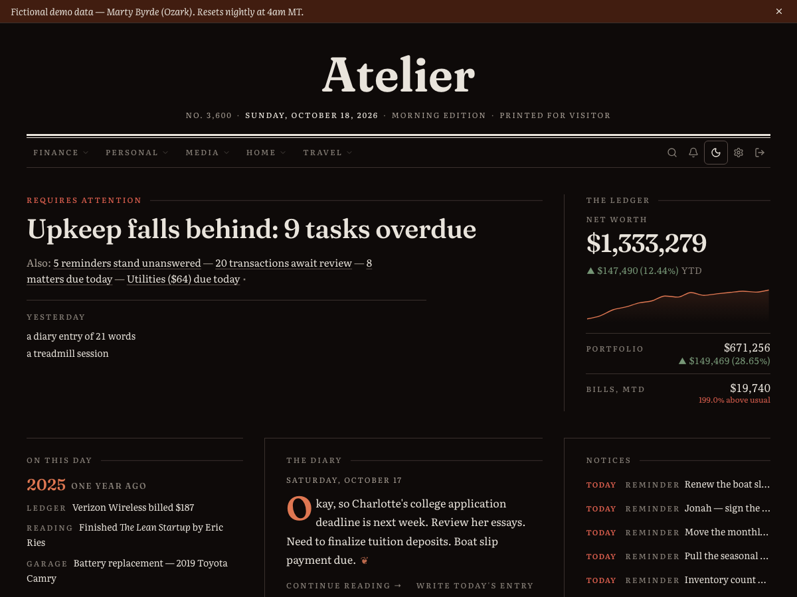
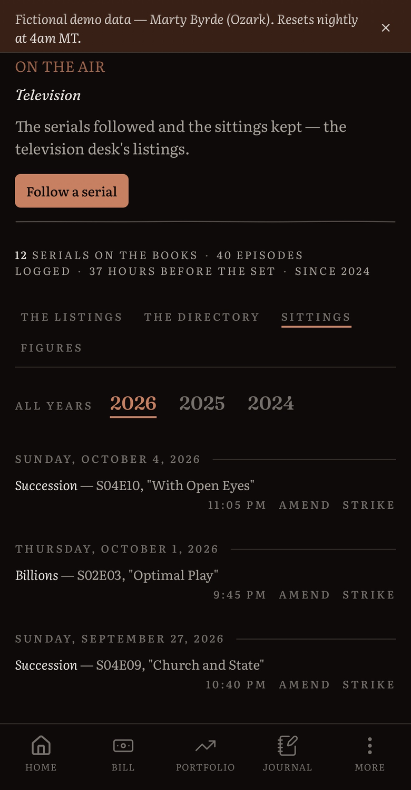
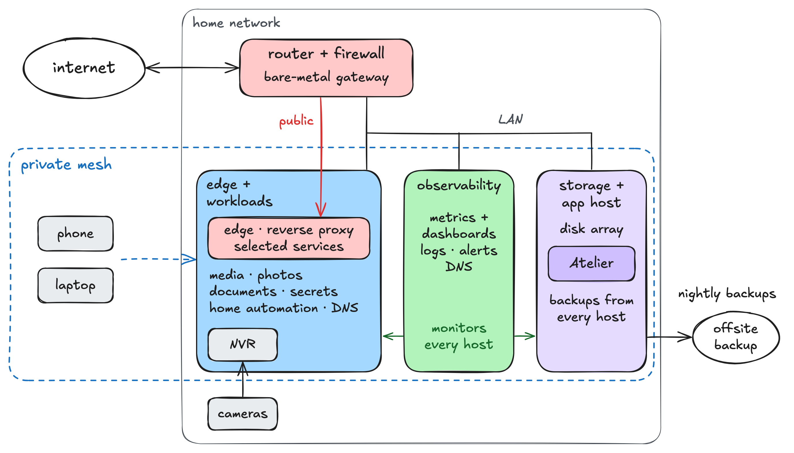

I'm a full-stack and platform engineer (Python, TypeScript, AWS). I work AI-first: I design the system, direct coding agents (Claude Code, Kiro) through the build, and own review and what ships.

My contribution graph is almost all private repositories, because they run my household: finances, home network and personal data. I'm happy to walk through the architecture on a call.

## Atelier

One self-hosted app in place of the commercial products I used for budgeting, journaling, and media and portfolio tracking.

  
  

*The front page on desktop and the television section in the iOS app. Demo instance, fictional data.*

- **Stack:** FastAPI, React and TypeScript on Vite, PostgreSQL, and an Ofelia scheduler running 30+ jobs, all under Docker Compose. Read-only endpoints use a SELECT-only database role. Auth is JWT in httpOnly cookies with a sliding refresh token.
- **Households:** one deployment serves several households, each opened by invitation. PostgreSQL row-level security keeps their rows apart, and each household's jobs run on its own clock. Owners invite members, connect their own outside services and switch agent desks on.
- **Modules (17):** accounts, transactions, portfolio, credit cards, bills, journal, todo, workouts, timeline, movies, TV, books, movie theater, maintenance, bar cart, coffee, travel log. Each reader chooses which ones appear.
- **Finance:** SimpleFIN bank data lands twice a day as raw payloads, moves through vendor-shaped staging tables into canonical accounts, balances, transactions and holdings, and is reconciled weekly. Categories come from fuzzy matching against the ledger; an LLM-assisted review audits each month, and its corrections ship as reviewed migrations.
- **Agents:** seven LLM analysts run outside the app as headless Claude Code sessions, reading through per-agent MCP endpoints and writing through scoped database roles. They file a month-close cash-flow report, a weekly digest, card-renewal reviews, a weekly pick from the local cinema schedule, and travel entries drafted from photo metadata. A SQL check, never the model, decides whether my phone is notified.
- **Operations:** image-based releases with rollback, post-deploy smoke tests, OpenTelemetry tracing, and nightly checks that open their own fix PRs.
- **Notifications:** an in-app bulletins panel, APNs push to the iOS app and Web Push to browsers.
- **Integrations:** 14 outside services, including SimpleFIN, TMDB, Google Books and the National Park Service API.
- **iOS:** a thin Capacitor shell on my phone that loads the live web app over my private network, so frontend changes need no iOS rebuild.

## homedock

The homelab, defined as code in one repo. Atelier runs on it.

<picture>
  <source media="(prefers-color-scheme: dark)" srcset="assets/homelab-topology-dark.png">
  
</picture>

*Topology by role. Hosts and addresses omitted.*

- **Nodes:** three Docker hosts and a bare-metal router: one for edge and workloads, one for observability, one for storage and Atelier.
- **Orchestration:** plain Docker Compose, with one stack per role on each host and one YAML index.
- **Services:** media and photo libraries, documents, monitoring and logging (Prometheus, Grafana, Loki), DNS, reverse proxies, secrets, a camera NVR, home automation.
- **Deploys:** commit, push, pull on the owning host, bring up the one changed service. Every `.env` is rendered from a self-hosted secrets manager. Backups run nightly; restores are drilled monthly.

## dictate

A macOS menu-bar dictation app: press a hotkey, speak, and cleaned-up text is pasted at the cursor.

- Transcription (whisper.cpp) and clean-up (a small Gemma model under Ollama) run as native daemons on a homelab node, reachable only over my private network. No cloud API.
- Swift 6 with strict concurrency, Swift Package Manager and AppKit, around a pure-Foundation core.

## Smaller projects

- **portfolio-review** — scheduled agent sessions that review my holdings against written rules and file a brief into Atelier.
- **crypto** — market-data collection into Postgres and DuckDB, with a strategy backtesting pipeline.
- **denver-concert-monitor** — scrapes nine concert sources, deduplicates them and posts new shows to Discord.
- **lightroom** — photo culling for Lightroom Classic: scores frames, groups near-duplicates, proposes rejects.
